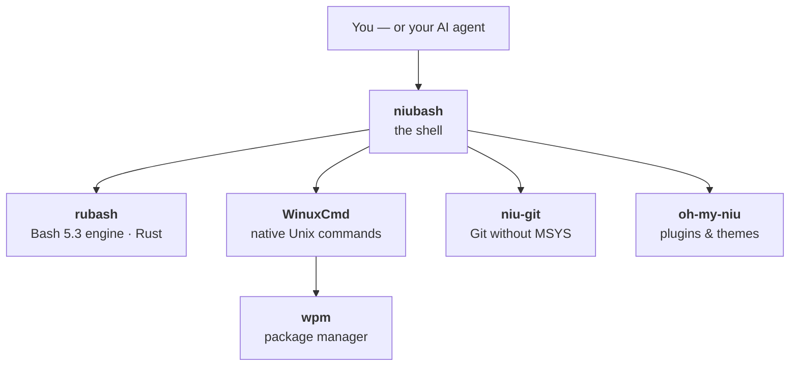

# unixwin

### Real Bash and Unix commands — native on Windows

**No WSL · No MSYS · No POSIX emulation layer**

  
  
  
  

  <a href="https://unixwin.dev"><strong>🌐 Website</strong></a> ·
  <a href="https://github.com/unixwin/niubash/releases"><strong>📥 Downloads</strong></a> ·
  <a href="https://unixwin.dev"><strong>📚 Docs</strong></a> ·
  <a href="https://github.com/unixwin/.github/blob/main/CONTRIBUTING.md"><strong>🤝 Contributing</strong></a>

**unixwin** builds a Windows-native Unix command stack for developers and AI agents: a real Bash shell, the engine behind it, the core Unix commands, a Git distribution, a package manager, and a plugin framework — composable Unix workflows that run natively on Windows, with no WSL and no emulation layer in between.

## The family

<table>
  <tr>
    <th align="left" width="190">Project</th>
    <th align="left">What it is</th>
    <th align="left" width="170">Get it</th>
  </tr>
  <tr>
    <td>
      🐂 <a href="https://github.com/unixwin/niubash"><strong>niubash</strong></a> 
      
    </td>
    <td>
      <strong>The shell.</strong> Real Bash for humans and AI agents — the interactive experience (REPL, completion, prompt, history) on top of the family stack. 
      Rust · native on Windows, Linux &amp; macOS · no WSL, no MSYS
    </td>
    <td>
      <a href="https://github.com/unixwin/niubash/releases">Releases</a> ·
      <a href="https://unixwin.dev">Docs</a>
    </td>
  </tr>
  <tr>
    <td>
      🧰 <a href="https://github.com/unixwin/WinuxCmd"><strong>WinuxCmd</strong></a> 
      
    </td>
    <td>
      <strong>The commands.</strong> 176 Unix commands in one ~3 MB native Windows executable — real Windows paths, no path-translation pain. Usable standalone today; also serves as niubash's coreutils layer. 
      C++ · Windows x64 &amp; ARM64 · v1.0.0 stable is out
    </td>
    <td>
      <a href="https://github.com/unixwin/WinuxCmd/releases">Releases</a> ·
      <a href="https://unixwin.dev">Docs</a>
    </td>
  </tr>
  <tr>
    <td>
      🦀 <a href="https://github.com/unixwin/rubash"><strong>rubash</strong></a> 
      
    </td>
    <td>
      <strong>The engine.</strong> A from-scratch, embeddable GNU Bash 5.3-compatible shell engine in Rust — parser, executor, builtins and all. Compatibility is measured, not claimed: 83/83 against GNU Bash's own upstream test-suite corpus. 
      Rust · embeddable library · native on Windows, Linux &amp; macOS
    </td>
    <td>
      <a href="https://github.com/unixwin/rubash">Repository</a> ·
      <a href="https://unixwin.dev">Docs</a>
    </td>
  </tr>
  <tr>
    <td>
      🔀 <a href="https://github.com/unixwin/niu-git"><strong>niu-git</strong></a> 
      
    </td>
    <td>
      <strong>The Git.</strong> A native Windows Git distribution without MSYS — built with MSVC, no bash/perl/MSYS2 bundled. The fast-starting Git that niubash ships; its shell-script parts run on niubash itself. 
      MSVC + CMake · Windows
    </td>
    <td>
      <a href="https://github.com/unixwin/niu-git">Repository</a>
    </td>
  </tr>
  <tr>
    <td>
      🎨 <a href="https://github.com/unixwin/oh-my-niu"><strong>oh-my-niu</strong></a> 
      
    </td>
    <td>
      <strong>The customization.</strong> The official Oh My-style plugin framework and bundled plugin distribution for niubash — plugins, themes, and prompt customization. 
      Python · plugins are directories, themes are plugins
    </td>
    <td>
      <a href="https://github.com/unixwin/oh-my-niu">Repository</a>
    </td>
  </tr>
  <tr>
    <td>
      🌐 <a href="https://github.com/unixwin/unixwin.dev"><strong>unixwin.dev</strong></a> 
      
    </td>
    <td>
      <strong>The website.</strong> Docs, downloads, and live changelogs for the whole family — the source of <a href="https://unixwin.dev">unixwin.dev</a>. 
      Astro · day/night themes
    </td>
    <td>
      <a href="https://unixwin.dev">Visit site</a> ·
      <a href="https://github.com/unixwin/unixwin.dev">Repository</a>
    </td>
  </tr>
</table>

## Start here

| If you want… | Start with |
| --- | --- |
| A Unix-style shell on Windows | [niubash](https://github.com/unixwin/niubash) — the user-facing shell |
| Unix commands on Windows, today | [WinuxCmd](https://github.com/unixwin/WinuxCmd) — standalone, one small executable |
| A Bash-compatible engine to embed | [rubash](https://github.com/unixwin/rubash) — the shell language engine |
| Git on Windows without MSYS | [niu-git](https://github.com/unixwin/niu-git) — niubash's Git companion |
| Themes, plugins, prompt customization | [oh-my-niu](https://github.com/unixwin/oh-my-niu) — the configuration ecosystem |
| Docs, downloads, changelogs | [unixwin.dev](https://unixwin.dev) — the family portal |

## Why unixwin exists

AI agents, CI jobs, documentation, and developers constantly produce Unix-style commands — `grep`, `find`, `xargs`, `sed`, shell pipelines. On Windows those workflows usually detour through WSL, Git Bash, or per-shell workarounds, and the emulation layer leaks quirks into every script.

unixwin makes that layer native instead: real Bash semantics from a from-scratch engine, real Unix commands built for Windows paths, and predictable behavior for both humans and agents — the shell your fingers already know, and the one your AI agent actually speaks.

## Get involved

- 📖 Read the [contributing guide](https://github.com/unixwin/.github/blob/main/CONTRIBUTING.md) — it covers how work is organized across the family.
- 🐛 Found a bug or a compatibility gap? File it in the repo it belongs to — compatibility reports with a GNU Bash comparison are gold.
- 💬 Questions and ideas are welcome in the relevant repo's issues.

<strong>Supporting repositories</strong> — the WPM ecosystem and more

 

| Repository | Role |
| --- | --- |
| [wpm-source](https://github.com/unixwin/wpm-source) | Curated WPM index for standalone Windows command-line binaries |
| [wpm-artifacts](https://github.com/unixwin/wpm-artifacts) | Self-hosted portable binary artifacts for WPM (mirrors + CI builds, sha256 manifests) |
| [wpm-gui](https://github.com/unixwin/wpm-gui) | GUI front-end for the wpm package manager |
| [winuxcmd-i18n](https://github.com/unixwin/winuxcmd-i18n) | Optional WinuxCmd language catalogs |
| [winuxsh-profiles](https://github.com/unixwin/winuxsh-profiles) | Example configuration profiles and WPM package presets |
| [codex](https://github.com/unixwin/codex) | Lightweight coding agent that runs in your terminal (fork) |

## 中文简介

UNIXWIN 是面向 Windows 与 AI agent 的原生命令行基础设施：`niubash` 作为用户入口（真实 Bash、原生运行），`rubash` 提供从零实现的 GNU Bash 5.3 兼容引擎，`WinuxCmd` 提供 176 个原生 Unix 命令，`niu-git` 提供无 MSYS 的 Git 发行，`oh-my-niu` 提供插件与主题框架。目标不是把 Windows 变成 Linux，而是在 Windows 上原生提供可组合、可脚本化、agent 友好的 Unix 命令体验——不用 WSL，不用仿真层。官网：[unixwin.dev](https://unixwin.dev)。

  unixwin — real Unix tooling, native on Windows · <a href="https://unixwin.dev">unixwin.dev</a>

